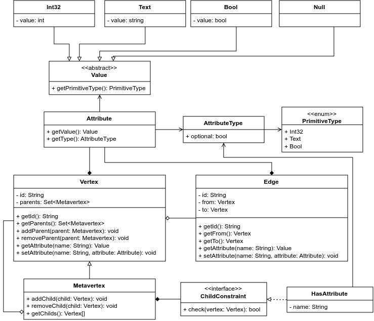
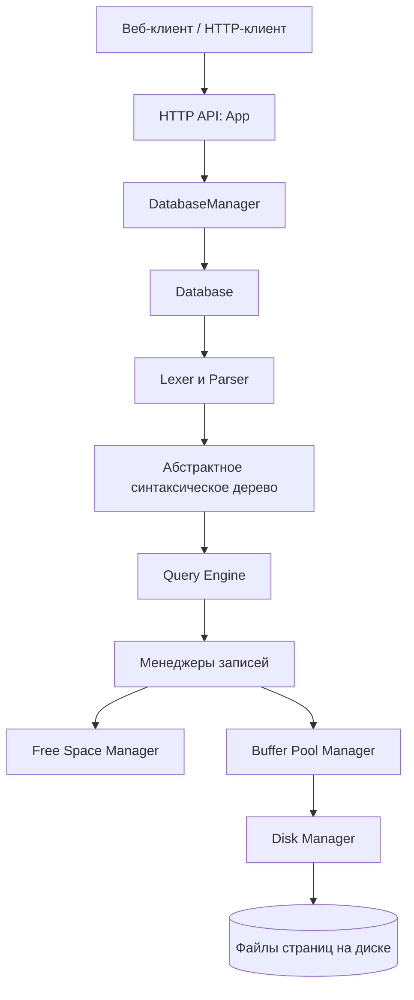

# Прототип метаграфовой СУБД

Исследовательский прототип системы управления базами данных на **Rust**, в которой метаграф используется как основная модель хранения данных.

Идея проекта — объединить естественное представление графовых связей с возможностью явно задавать структуру и типы данных. Метаграф позволяет описывать классификацию, генерализацию и агрегацию, в том числе **множественное наследование**, а также работать с сущностями разной степени структурированности без необходимости сводить каждую структуру к набору реляционных таблиц.

Это не обёртка над существующей СУБД: в рамках проекта реализованы собственный формат дискового хранения, страничный кеш, язык запросов, парсер, движок выполнения и базовый механизм отката изменений.

## Зачем нужен проект

В реляционной модели связи между сущностями обычно описываются через таблицы и внешние ключи, а иерархии типов требуют дополнительных схемных соглашений. В прототипе метаграфовой СУБД связи и вложенность представлены непосредственно в модели данных, а метавершины могут задавать структуру дочерних узлов.

Это позволяет исследовать единый подход к хранению:

- **Связанных данных** — вершины и рёбра являются непосредственными элементами модели.
- **Иерархий типов** — метавершины задают ограничения на структуру дочерних узлов и могут наследоваться несколькими родительскими метавершинами.
- **Данные с различной степенью структурированности** — от узлов со строгими требованиями к атрибутам до узлов со свободным набором атрибутов.
- **Составных и динамических сущностей** — с помощью метавершин, объединяющих другие элементы метаграфа.

## Модель данных

Метаграф в проекте состоит из трёх типов элементов:

- **Вершина (`VERT`)** — узел с атрибутами и набором родительских метавершин.
- **Метавершина (`META`)** — узел, который может содержать другие вершины и метавершины, иметь собственные атрибуты и задавать ограничения для дочерних узлов.
- **Ребро (`EDGE`)** — направленная связь между двумя узлами метаграфа, также имеющая атрибуты.

Отношение между метавершиной и дочерними узлами может использоваться для классификации, генерализации или агрегации. Для проверки структуры дочерних узлов реализовано ограничение `HasAttribute`: оно проверяет наличие атрибута с заданным именем и типом.

Поддерживаемые типы атрибутов: `int32`, `text` и `bool`. Тип может быть опциональным — это обозначается символом `?`.



## Возможности прототипа

- Хранение нескольких изолированных баз данных в отдельных директориях.
- Собственный формат хранения элементов метаграфа на диске.
- Страничная организация данных с размером страницы **4 КБ** и слотами фиксированной и переменной длины.
- Двоичное кодирование записей и адресация записей указателями на страницу и слот.
- Кеширование страниц в оперативной памяти с политикой вытеснения **LRU-K**.
- Синхронизация доступа к страницам, защита от параллельной загрузки одной страницы и менеджер свободного пространства.
- Специализированный язык запросов для создания, поиска, изменения и удаления элементов метаграфа.
- Лексический и синтаксический анализ запросов с построением абстрактного синтаксического дерева (**AST**).
- Движок выполнения запросов и откат уже выполненных изменений при ошибке в запросе.
- HTTP-интерфейс и лёгкий веб-клиент с редактором запросов и табличным отображением результата.

## Язык запросов

Язык спроектирован с учётом структуры метаграфа и включает операции `FIND`, `CREATE`, `SET`, `DELETE`, `PARENT`, `UNPARENT` и `RETURN`. Поиск может описывать не только отдельные узлы, но и шаблоны связей между ними.

### Создание типа и экземпляра

```text
CREATE s:META student {}
CONSTRAINT ATTRIBUTE {
    name: text,
    age: int32,
    school: text?,
}
```

Метавершина `student` задаёт требования к атрибутам дочерних узлов. Создать экземпляр такого типа можно следующим запросом:

```text
CREATE x:VERT IN student {
    name: text = "Иванов Иван Иванович",
    age: int32 = 19,
    school: text? = "Школа №10",
}
```

### Поиск с фильтрацией

```text
FIND (x:VERT IN student)
WHERE x.age > 18
RETURN x.name, x.age
```

### Поиск связанных данных

```text
FIND (x IN student)-[e]-(y IN group)
WHERE x.age > 18
RETURN x.name, e
```

Примеры иллюстрируют основные конструкции языка. Полный набор допустимых конструкций определяется грамматикой, реализованной в парсере.

## Архитектура

Обработка запроса проходит через HTTP-точку входа, менеджер баз данных, парсер и движок запросов. Для доступа к физическому хранилищу движок использует слой менеджеров записей, менеджер буферного пула и компонент дискового ввода-вывода.



## Физическое хранение

Логические элементы метаграфа представлены несколькими типами записей, которые размещаются в отдельных пространствах страниц. Структурные записи фиксированной длины позволяют адресовать узлы и рёбра через указатели, а атрибуты и другие данные переменной длины хранятся отдельно.

Страничный слой включает:

- **Страницы фиксированной длины** — для записей одинакового размера, со свободными слотами, отслеживаемыми битовой картой.
- **Страницы переменной длины** — с дескрипторами слотов и механизмом дефрагментации.
- **Buffer Pool Manager** — управляет кешем страниц, закреплением страниц на время использования, записью изменённых страниц и вытеснением по LRU-K.
- **Free Space Manager** — хранит метаинформацию о свободном месте и помогает находить страницу для новой записи без полного перебора.

Для ребра поддерживается запись с указателями на исходный и целевой узлы, атрибуты и следующие рёбра в списках исходящих и входящих связей. Благодаря этому ребро хранится в одном экземпляре и доступно при обходе связей с обеих сторон.

## Транзакционность и целостность

Атомарность реализована **на уровне одного запроса**. Во время выполнения изменения регистрируются в контексте запроса. Если одна из операций завершается ошибкой, движок проходит по журналу изменений в обратном порядке и выполняет компенсирующие действия.

Для согласованности данных при создании дочерних узлов проверяются ограничения соответствующих метавершин. При этом уровень изоляции конкурентных операций ограничен **Read Uncommitted**.

Долговечность реализована частично: изменённые страницы записываются на диск при вытеснении из кеша, при штатном завершении работы и фоновым процессом с периодическим интервалом. Полноценное журналирование WAL в прототипе не реализовано.

## Технологии

- **Rust** — реализация СУБД и низкоуровневых компонентов хранения.
- **HTTP** — взаимодействие с клиентскими приложениями.
- **Одностраничный веб-клиент** — редактирование запросов, подсветка и проверка синтаксиса, отображение результатов в табличной форме.

